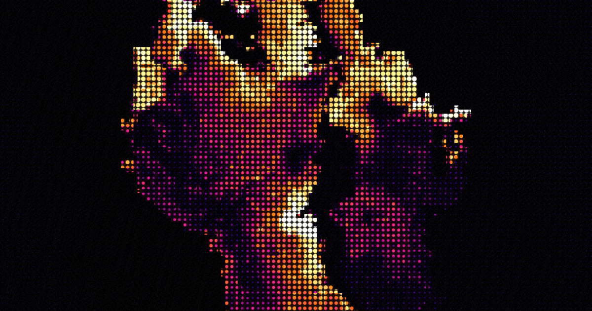
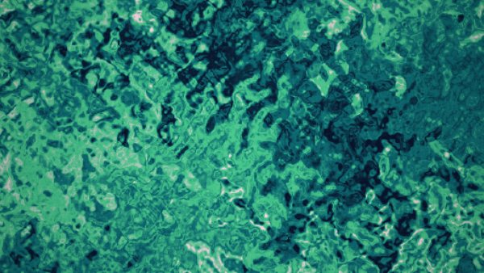
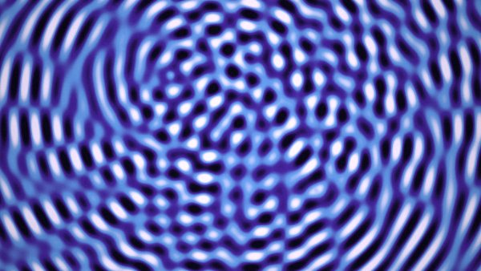
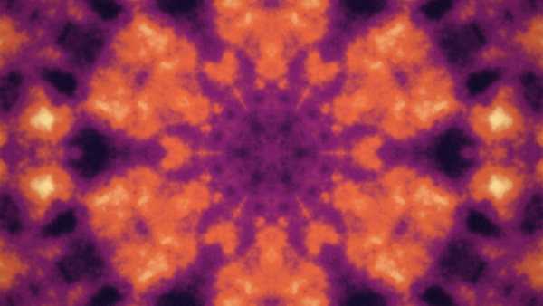
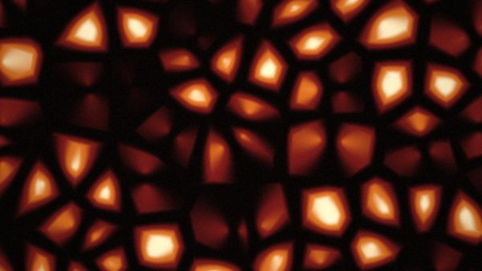
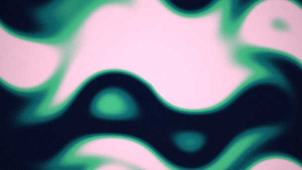
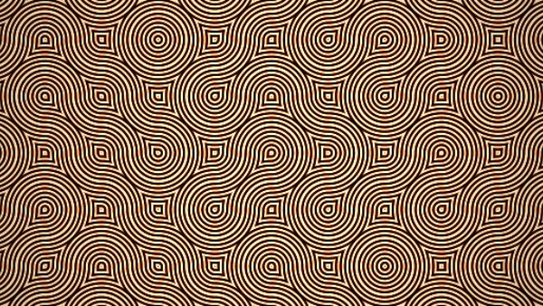

<div align="center">



# Fluid

Dependency-free WebGL studio for generating backgrounds, wallpapers, Open Graph
images, and live embeddable canvases.

One HTML file. No build step. No backend state. No runtime dependencies.

[](LICENSE)
&nbsp;[](https://fluid.krackeddevs.com)
&nbsp;[](#quick-start)
&nbsp;[](https://www.npmjs.com/package/fluid-bg)
&nbsp;[](https://www.npmjs.com/package/fluid-core)

[Studio](https://fluid.krackeddevs.com) ·
[Gallery](https://fluid.krackeddevs.com/gallery) ·
[Manual](https://fluid.krackeddevs.com/manual) ·
[Dev/API](https://fluid.krackeddevs.com/dev)

</div>

## Features

- WebGL1 fragment-shader renderer with 24 field engines, including a quasicrystal, paper marbling, string-art caustics, whirling pursuit polygons, Chladni plate figures, Cassini ovals, topographic contours, and a von Karman vortex street.
- Kaleidoscope symmetry modifier: fold any field into an N-fold radial mandala.
- Layers: stack up to three engines, each blending onto everything under it with multiply / screen / add / difference / overlay.
- Math lenses: bend the plane through 12 conformal maps — z², 1/z, Möbius, Droste, hyperbolic, Julia, z³, e^z, sin z, Joukowski, Newton basins, and the SL(2,ℤ) modular fold — plus Ground, which is a camera rather than a map: it tips the plane away so any engine recedes to a horizon.
- Material finishes: glass, metal, sand, liquid, and molten relighting, plus paint — impasto oil, dabs laid along the field's contours with bristle ridges, lit as thick paint on a toned canvas.
- Square, hex, ASCII, halftone, ordered-dither, and glitch surface modes.
- Preset palettes plus shareable custom four-stop gradients, with a draggable colour editor: saturation/brightness pad, hue strip, HSB and RGB sliders, hex, and harmony schemes that rebuild the whole ramp from one hue.
- Optional image melt: uploaded image luminance drives the field.
- Text in living colour: fill a word or brand name with the field, with a 9-font picker and a background-colour choice; persists locally and travels in share links.
- Exact-size export as PNG, JPG, or WebP.
- Self-contained HTML export: copy the piece as a complete, dependency-free file with the shaders inlined — no iframe, no server.
- Clip recording through `MediaRecorder`.
- Undo across the session, with a Recent shelf of every state you passed through as thumbnails.
- Explore: a fresh shelf of generated pieces on every open, rendered on the spot — plus a seed of the day, one piece per UTC day, the same for everyone.
- URL hash format that round-trips every piece without server storage.
- Cloudflare Worker API and Streamable HTTP MCP endpoint.

## Examples

<p align="center">
<a href="https://fluid.krackeddevs.com/#p=0.5,1.5,5.5,0.03,1,10,0,0,18,0,0,1.7778,0,0,1" title="Aurora Flow"></a>
<a href="https://fluid.krackeddevs.com/#p=0.5,1.4,6,0.03,1,10,0,6,52,0,0,1.7778,0,0,5" title="Pulse"></a>
<a href="https://fluid.krackeddevs.com/#p=0.4,1.5,5,0.03,1,10,0,1,33,0,0,1.7778,0,0,6" title="Bloom"></a>
<a href="https://fluid.krackeddevs.com/#p=0.4,1.9,8,0.03,1,10,0,4,60,0,0,1.7778,0,0,2" title="Magma Cells"></a>
<a href="https://fluid.krackeddevs.com/#p=0.4,1.6,4.5,0.03,1,10,0,0,28,0,0,1.7778,0,0,3" title="Ribbon"></a>
<a href="https://fluid.krackeddevs.com/#p=0.4,1.8,3.5,0.03,1,10,0,4,44,0,0,1.7778,0,0,4" title="Wiring"></a>
</p>

Each thumbnail opens the live piece in the studio.

## Quick Start

```sh
git clone https://github.com/enonforetsam/fluid
cd fluid
open index.html
```

For the Worker routes, security headers, JSON API, and MCP endpoint:

```sh
npm run dev            # http://localhost:8787
```

Use the script rather than a bare `npx wrangler dev`. The assets directory is the repo root,
so wrangler's own `.wrangler/state` writes land inside the tree it is watching — it sees them,
reloads, writes again, and reloads about once every four seconds forever, which makes requests
hang mid-reload. The script keeps that state outside the repo with `--persist-to`.

## Embed

Two npm packages ship from this repo. [`fluid-bg`](https://www.npmjs.com/package/fluid-bg)
is the drop-in background — it renders natively on a canvas in your page (~15 KB gz, no iframe):

```html
<script src="https://cdn.jsdelivr.net/npm/fluid-bg@0.3"></script>
<fluid-bg fixed hash="#p=0.5,1.5,5.5,0.03,1,10,0,0,18,0,0,1.7778"></fluid-bg>
```

React: `npm i fluid-bg`, then `import FluidBg from 'fluid-bg/react'`. Keep the page
background transparent when using `fixed` — see `fluid-bg/README.md`.

[`fluid-core`](https://www.npmjs.com/package/fluid-core) is the raw engine library
underneath (`createFluid(el, {…})`, zero dependencies, TypeScript types) — see
`fluid-core/README.md`.

No npm at all? A plain iframe still works:

```html
<iframe
  src="https://fluid.krackeddevs.com/#p=0.5,1.5,5.5,0.03,1,10,0,0,18,0,0,1.7778,0,1,1"
  title="Fluid background"
  loading="lazy"
  style="border:0;width:100%;height:100%">
</iframe>
```

The embed flag makes the canvas fill the iframe without the studio UI.

## What is open, what is hosted

Everything in this repo is MIT. What is not in the repo is befluid.xyz's data: the
published pieces, their authors, the media and the admin secrets. Clone it and you have
the whole studio; run the Worker with your own bindings and you have your own instance.

The share-hash contract (the `#p=` fields, append-only) is the project's real API and is
specified in [docs/ARCHITECTURE.md](docs/ARCHITECTURE.md#share-hash-contract).

## API

```sh
curl "https://fluid.krackeddevs.com/api/piece?look=borealis"
curl "https://fluid.krackeddevs.com/api/piece?field=flow&palette=sunset&warp=4"
curl "https://fluid.krackeddevs.com/api/piece?field=cellular&colors=0a0a1a,3a1f7a,c84fe0,ffe1f5"
curl "https://fluid.krackeddevs.com/api/looks"
curl "https://fluid.krackeddevs.com/api/today"            # the day's piece
curl "https://fluid.krackeddevs.com/api/today?date=2026-01-01"   # replay any day
```

`/today` is a permalink that opens the day's piece in the studio.

MCP clients that support Streamable HTTP can connect to:

```sh
https://fluid.krackeddevs.com/mcp
```

Claude Code:

```sh
claude mcp add --transport http fluid https://fluid.krackeddevs.com/mcp
```

On claude.ai (web, desktop, or mobile): Settings → Connectors → Add custom
connector → paste the `/mcp` URL. No auth. Tools: `create_piece`,
`get_embed_code`, `list_looks`, `get_seed_of_the_day`, `decode_link`.

AI agents without MCP can read the whole integration surface from
[`/llms.txt`](https://fluid.krackeddevs.com/llms.txt).

## Architecture

| File | Purpose |
|---|---|
| `index.html` | Complete studio app: UI, WebGL shader, state, export, recording, sharing |
| `worker.js` | Cloudflare Worker: static assets, security headers, API, MCP, OG image rotation |
| `gallery.html` | Curated examples and downloadable preview images |
| `manual.html` | User reference |
| `dev.html` | Embed, API, and MCP reference |
| `fluid-core/` | Zero-dependency native canvas library on npm — shader + engine/palette/look tables generated from `index.html` by `fluid-core/build.mjs`, plus a small mount runtime; see `fluid-core/README.md` |
| `fluid-bg/` | npm package: `<fluid-bg>` web component + React wrapper built on `fluid-core`; see `fluid-bg/README.md` |
| `fluid-vibe/` | Prototype: client-side semantic "describe a vibe" matcher (transformers.js); not yet wired into the studio |
| `assets/` | Favicon, gallery previews, Open Graph images, and README media |

Important invariants:

- Keep the original WebGL Studio dependency-free. The separate React component gallery uses the pinned development toolchain below.
- Keep the shader source as joined string arrays.
- Preserve the append-only `#p=` share-hash field order.
- Keep mirrored constants in `index.html` and `worker.js` in sync.
- After changing engines, palettes, or looks, run `node fluid-core/build.mjs` — the test suite fails on drift.
- Scale screen-space shader sizes by the render scale `k` used for export.

See [docs/ARCHITECTURE.md](docs/ARCHITECTURE.md) for the share-hash contract and Worker mirror notes.

## Deploy

The hosted instance auto-deploys from `master` via GitHub Actions. To deploy
your own:

```sh
npx wrangler deploy
```

Staging:

```sh
npx wrangler deploy --env staging
```

Deployment requires Cloudflare credentials with Worker deploy access.

## Contributing

See [CONTRIBUTING.md](CONTRIBUTING.md). The most useful contributions are field
engines, palette presets, gallery pieces, manual fixes, and bug reports with a
share link.

## License

MIT. See [LICENSE](LICENSE).


## Published app

The public collection explorer, integrated 3.3 Studio, Photo → Fire, background builder and image dither generator live in `site/`. Run `npm ci` on a fresh checkout, then `npm run build:site` to prepare the explicit `.public/` asset package, then `npm run dev` for the complete Worker locally. The build keeps QA, internal project notes, scripts and repository metadata out of public assets, while retaining `/manual`, `/gallery`, `/dev`, social images and native package URLs. Root artwork share/embed hashes continue into `/studio` with their settings preserved.

Publishing follows the existing master-branch GitHub Action, which builds assets and runs engine, dither and packaging tests before deployment. The original root studio remains the source for the existing 42-look API and offline engine tests; the bundled 58-look browser studio is served at `/studio`. This website release does not expand the API/MCP registry or deploy the separate hosted/community experiment.


## Fluid Components

The library at `/components` contains 39 creative pieces: 22 React components, eight browser-local tools, four complete page sections and five experiments. It offers live previews, controls, source/usage tabs, complete source ZIPs and supported image, vector, HTML, CSS, JSON or JSX exports. Phone browsing is compact and touch-friendly; editing state survives Code, Replay and palette changes. The previews import the exact JSX files and relative helpers visitors receive.

Run `npm ci` on a fresh checkout, `npm run build:components` after editing source or portable CSS, then `npm run build:site` and `npm test`. Both GitHub Actions install locked dependencies and rebuild the gallery before packaging. The explicit public allowlist includes reusable sources, helpers, CSS and full MIT notices, and excludes authoring gallery/registry/manifests, tests, QA and project notes.

Current browser harnesses are `scripts/qa-creative-suite.mjs`, `scripts/qa-creative-worker.mjs` and `scripts/qa-fluid-mobile.mjs`; `FLUID_QA_BASE`, `FLUID_QA_PLAYWRIGHT` and `FLUID_QA_CHROME` can target an existing test installation. The new Canvas2D/CSS materials are independent of the 58-look native engine. Local media stays in the browser; preset links omit images/audio. The suite does not add video recording or change the existing 42-look/five-tool API/MCP boundary. Physical devices and Safari remain untested. The earlier six-component verification is retained historically in `docs/verification/components-library.md`.

## Pixel homepage study — 30 October 2026

The homepage opens with the native Fluid wordmark rendered as 3,936 small squares. Four explicit controls morph those same squares into Fluid, Wave, Orbit or Bloom. The pixels ripple gently between shape changes, with a Pause/Play control and a target of 30 paints per second. Transitions can be retargeted; pause and hidden/offscreen states freeze both clocks. Reduced motion selects a complete still endpoint, and manual pause is preserved when the preference changes. A matching SVG appears without Canvas or JavaScript, while collection browsing remains independent of the optional artwork module. Featured WebGL studies are below the collections and mount only when visible.

Source: site/pixel-hero.js and site/pixel-hero-points.js. Reproduce all geometry and the fallback without dependencies: node scripts/generate-pixel-hero.mjs. Run npm run build:site and npm test after changes. No new runtime package, remote asset or service is required. The pixel homepage integrates with the existing creative-library release and uses the standard master-branch deployment workflow.
